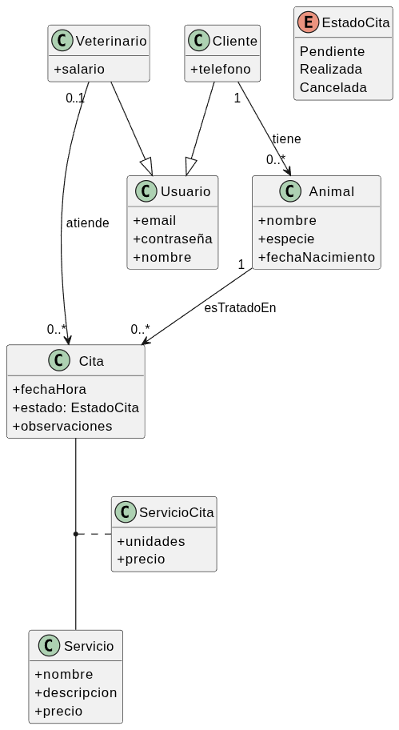

# Enunciado Evaluación Individual de Laboratorio - Modelo B
**Si usted entrega sin haber sido verificada su identidad no podrá ser evaluado.**

## Clínica veterinaria

Partiendo de la base de datos de una clínica veterinaria descrita en el fichero `0.creacionTablas.sql`, los datos iniciales se encuentran en `0.poblarBd.sql`. Para preparar y probar las soluciones, puede usar `0.poblarBdParaProbarSoluciones.sql`.

### Diagrama UML de clases de la estructura inicial

El diagrama representa las tablas iniciales de la base de datos. No incluye `PlanesSalud`, la tabla que se solicita crear en el ejercicio 1.

Realice los siguientes ejercicios:

### 1. Creación de tabla. (1,5 puntos)

Incluya su solución en el fichero `1.solucionCreacionTabla.sql`.

La clínica ofrece planes de salud para los animales. Cree una tabla llamada `PlanesSalud`. Cada animal podrá tener como máximo un plan de salud y no todos los animales tendrán uno. Cada plan pertenecerá a un animal.

Para cada plan se almacenará la fecha de inicio, la fecha de fin y si incluye cobertura de urgencias. Asegure que la fecha de fin sea posterior a la fecha de inicio.

### 2. Consultas SQL (DQL). (3 puntos)

Incluya su solución en el fichero `2.solucionConsultas.sql`.

#### 2.1. Devuelva el nombre del servicio, el nombre de su modalidad y el precio unitario de los servicios incluidos en citas de modalidad «Teleconsulta». (1 punto)

#### 2.2. Devuelva el nombre de cada veterinario, el número de citas realizadas durante el año actual cuyo importe supere los 150 euros y el importe total de esas citas. Deben aparecer también los veterinarios que no hayan gestionado ninguna cita que cumpla estas condiciones. Ordene de mayor a menor importe total. (2 puntos)

### 3. Procedimiento. Actualizar precio de un servicio y líneas de citas pendientes. (3,5 puntos)

Incluya su solución en el fichero `3.solucionProcedimiento.sql`.

Cree un procedimiento que permita actualizar el precio de un servicio dado y que actualice también el precio de las líneas de cita asociadas a ese servicio únicamente cuando la cita esté pendiente. (1,5 puntos)

Asegure que el nuevo precio no sea más de un 50% inferior al precio actual y lance una excepción si se incumple, con el siguiente mensaje: (1 punto)

`No se permite rebajar el precio más del 50%`.

Garantice que o bien se realizan todas las operaciones o bien no se realiza ninguna. (1 punto)

### 4. Trigger. (2 puntos)

Incluya su solución en el fichero `4.solucionTrigger.sql`.

Cree un trigger llamado `t_asegurar_misma_modalidad_en_citas` que impida añadir a una cita un servicio cuya modalidad sea distinta de la modalidad de los servicios que ya contiene. Una cita sin servicios podrá recibir su primer servicio de cualquier modalidad.

## Procedimiento de entrega

### 1. Comprimir ficheros

Cree un fichero `zip` que incluya los ficheros:

* `1.solucionCreacionTabla.sql`
* `2.solucionConsultas.sql`
* `3.solucionProcedimiento.sql`
* `4.solucionTrigger.sql`

### 2. Subir fichero `zip`

Suba el `zip` como fichero de solución en el examen de enseñanza virtual. **No pulse aún en enviar.**

### 3. Avisar al profesor ANTES de realizar la entrega

Antes de realizar la entrega, levante la mano y muestre su DNI o similar al profesor del aula para la verificación de su identidad.

**Si usted entrega sin haber sido verificada su identidad no podrá ser evaluado.**
